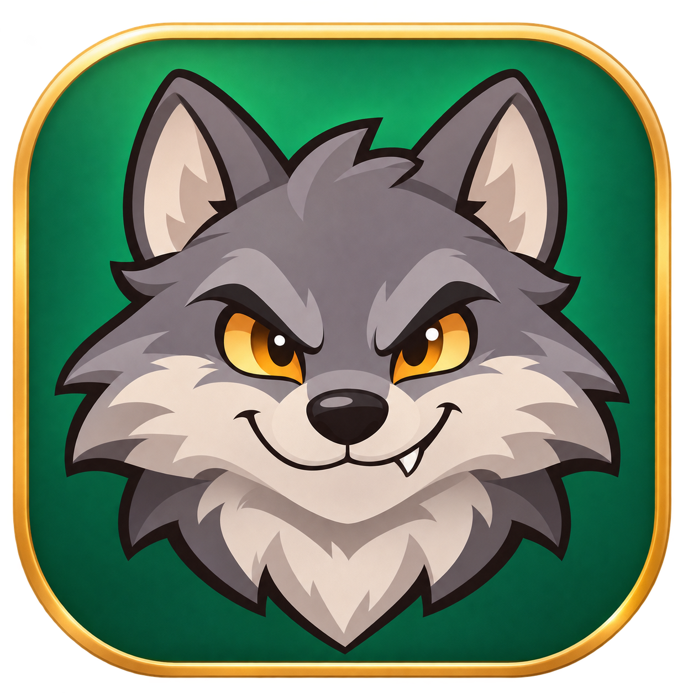

# SheepDogWolf · macOS



Личная нативная версия **Sheep, Dog ’n’ Wolf** для Mac с Apple Silicon — с русскими текстами и дубляжом, привычным управлением и графикой через Metal.

**Версия 1.2.4 · macOS 13+ · arm64 · Metal / CoreAudio**

Проект предназначен для личного использования с собственной копией оригинальной игры. Windows-исполняемые файлы и слой совместимости для запуска не нужны.

## Что входит в сборку

- **Русский язык:** меню, подсказки, диалоги, кириллический шрифт и отдельная иллюстрация выбора языка.
- **Русская озвучка с помощью ИИ:** полный набор из 146 игровых WAV, сохранённые длительности сцен, музыка и эффекты между репликами. Во вступлении — голосовой кредит каналу «Точки над ИИ».
- **Управление для Mac:** WASD, удержание Shift для бега, E/ЛКМ для действия, Ctrl/ПКМ для подкрадывания и укрытия.
- **Сохранение прогресса:** новый пункт в меню паузы, четыре слота и подтверждение перезаписи. Сохраняются пройденные уровни и бонусы; позиция и состояние предметов внутри уровня не записываются.
- **Ручная камера:** выбранный угол сохраняется при движении и прыжках; возле препятствий сокращается расстояние до персонажа. F приближает камеру к глазам без самостоятельного разворота. Мышь также управляет обзором в зонах с ограничением поворота и в направленных режимах движения (узкие проходы, лазание); постановочные сцены сохраняют свою камеру.
- **Чёткая картинка:** масштаб рендеринга до 200%, MSAA 4x и фильтрация текстур. Полная замена текстур на HD не выполнялась.
- **Понятные меню:** выбранная строка выделена белым цветом и подчёркиванием, выход в главное меню отличается от закрытия игры.
- **Табличка канала:** отдельный объёмный объект в обучении, деревянные торцы и задник, диалог перехода в [«Точки над ИИ»](https://t.me/TochkiNadAI). Подписка не выполняется автоматически.

## Управление

| Действие | Стандартные клавиши |
|---|---|
| Движение | W / A / S / D |
| Бег | Удерживать Shift |
| Красться / укрыться | Удерживать Ctrl или ПКМ |
| Действие, разговор, взять предмет | E или ЛКМ |
| Прыжок / двойной прыжок | Space / повторное нажатие в воздухе |
| Поворот камеры | Мышь; Q / R — поворот клавишами |
| Вид от первого лица | Удерживать F |
| Выбор предмета | Удерживать Tab, A/D или стрелки; отпустить Tab для выбора |
| Карта | M |
| Пауза | Esc |

**Как прятаться:** в кусте удерживайте Ctrl/ПКМ. У подходящего камня подойдите сбоку и двигайтесь к нему с зажатой Ctrl/ПКМ. Это контекстное применение той же команды, что и подкрадывание.

**Предметы:** подберите предмет через E/ЛКМ, когда действие доступно. Удерживайте Tab, выберите A/D или стрелками, отпустите Tab. Для освобождения рук выберите пустой слот. Применение через E/ЛКМ зависит от предмета и ситуации. При пустом инвентаре круг не открывается.

Справка доступна по кнопке **«Управление»** в запускаторе. Клавиатуру можно переназначить в игровых настройках. Миграция прежней раскладки применяется однократно; последующие пользовательские изменения сохраняются.

## Установка личной сборки

Откройте локальный `SheepDogWolf-macOS-arm64-1.2.4.dmg` и перетащите приложение в «Программы». Внутри `.app` уже находятся ресурсы личной копии игры. Выберите русский язык, если он ещё не выбран.

Для значка запуска на рабочем столе используйте `python3 tools/create_desktop_shortcut.py /Applications/SheepDogWolf.app`. Используется новая иконка с мультяшным серым волком. Исходный значок ножа и вилки сохранён в `res/icon-classic.png`. Ярлык ссылается на выбранное приложение; после его переноса ярлык нужно создать заново.

Приложение подписано локальной **ad-hoc** подписью. Developer ID и notarization Apple не выполнены. Intel Mac и чистая установка на другом Mac не проверены.

## Сборка из исходников

Нужны Command Line Tools, CMake 3.20+, Python 3, Pillow, NumPy и FFmpeg. Игровые ресурсы берутся из собственной локальной копии. Секреты, оригинальные архивы, `.app` и `.dmg` в этот Git-репозиторий не входят.

```sh
cmake -S . -B build-mac \
  -DCMAKE_BUILD_TYPE=RelWithDebInfo \
  -DCMAKE_OSX_DEPLOYMENT_TARGET=13.0 \
  -DSDW_REPOSITORY= -DSDW_VERSION=1.2.4-mac.1
cmake --build build-mac --target SheepLauncher sdw_langexport resource_validation_tests jpeg_validation_tests -j 6
```

Версии и хеши зависимостей закреплены в CMake. Для уже загруженных исходников доступны `FETCHCONTENT_SOURCE_DIR_SDL3` и `FETCHCONTENT_SOURCE_DIR_IMGUI`.

Экспортируйте основу шрифта в новую папку и соберите русский пакет, подставив свои пути:

```sh
build-mac/sdw_langexport /path/to/GameData /path/to/font-export
python3 tools/build_russian_pack.py \
  /path/to/font-export /path/to/GameData/Languages/01-Russian \
  --font '/System/Library/Fonts/Supplemental/Arial Narrow Bold.ttf' \
  --game-data /path/to/GameData
```

Готовые русские записи находятся в `localization/ru/voices`; повторная генерация TTS для сборки не требуется. Чистый невербальный файл восстанавливается из локального оригинала, остальные файлы проверяются по SHA-256 манифеста.

```sh
python3 tools/package_macos.py \
  --app build-mac/Rewooled.app --data /path/to/GameData \
  --sdl /path/to/SDL3 --imgui /path/to/imgui \
  --output /path/to/new/SheepDogWolf.app
```

Упаковщик использует новую выходную папку, проверяет состав данных, включает лицензии и подписывает приложение. Для DMG поместите `.app` и ссылку на `/Applications` в отдельный каталог:

```sh
hdiutil create -volname SheepDogWolf -srcfolder /path/to/staging \
  -format UDZO /path/to/SheepDogWolf-macOS-arm64-1.2.4.dmg
hdiutil verify /path/to/SheepDogWolf-macOS-arm64-1.2.4.dmg
```

## Проверки и известные ограничения

- Проверки WAR/DAV: 46 реальных контейнеров плюс усечённые и переполненные входы; UBSan.
- Проверки JPEG: 110 галерей, размеры, повреждённые входы и защитные пиксели.
- Дубляж: 146 WAV прошли автоматическую проверку полноты, начала/конца слов, остатков английской речи и наложений. Допуск связан с хешами конкретных файлов. Десять регрессионных тестов проверяют монтаж и нарезку.
- Инвентарь: изолированные тесты настоящих функций движка с UBSan проверяют списки подбора, стопки предметов, выбор в обе стороны, пустые руки и удаление использованных предметов. Карта с предметами проверена в игре. Применение всех предметов во всех уровнях ещё не пройдено.
- Камера, F, Ctrl/ПКМ, пункты меню и табличка проверялись в игре. Исправлено влияние материала таблички на глубину следующих объектов.
- Общая проверка загрузки 21 сцены не заменяет прохождение кампании. Длительная игра, все сохранения/загрузки, сон/пробуждение и другой Mac требуют отдельного прогона.
- Голос Даффи последователен, но **выраженная утиная шепелявость пока не достигнута стабильно**. Пробы с повторами и искажениями исключены из игрового пакета.
- Антивирусный и статический анализ не являются гарантией отсутствия любых ошибок. ASan не считается пройденным: зависал при запуске.

```sh
python3 -m unittest discover -s tools -p test_dub_editing.py
python3 tools/test_inventory_logic.py
python3 tools/test_input_save_regressions.py
python3 tools/test_camera_zones.py
python3 tools/smoke_levels.py build-mac/SheepD3D /path/to/GameData /path/to/new-smoke-report
```

Сохранения: `~/Library/Application Support/Infogrames/Sheep, Dog'n Wolf DX7`. Для изолированных тестов используется `SDW_SAVE_DIR`. Диагностика камеры включается через `SDW_CAMERA_TRACE=1`.

## Документация и происхождение

- [Требования и незакрытые задачи](docs/TASKS_RU.txt)
- [Текущий статус проверки сборки](docs/MACOS_STATUS_RU.txt)
- [Процесс озвучки и контроль монтажа](docs/SPEECH_PIPELINE_RU.txt)
- [Лицензия движка](LICENSE), [обязательные уведомления](NOTICE.md), [лицензии компонентов](licenses/)

Права на оригинальную игру и её ресурсы принадлежат правообладателям. Смешанные голосовые файлы могут содержать оригинальную музыку и эффекты. Приватность репозитория не заменяет разрешение на распространение. Авторские уведомления использованных компонентов сохранены в исходниках и приложении.
